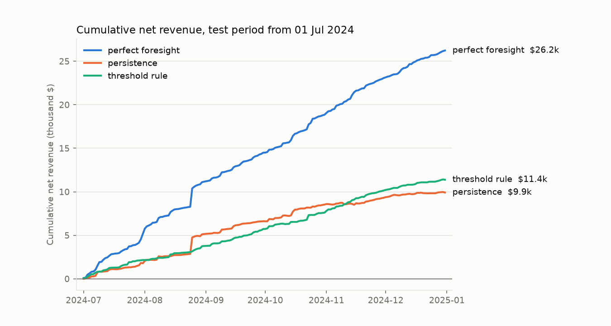
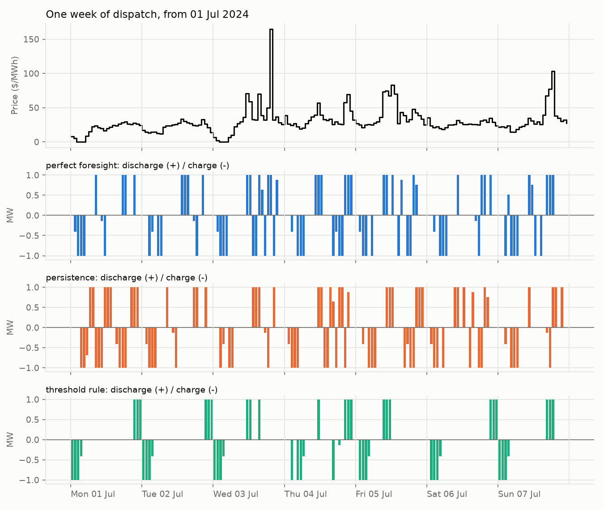
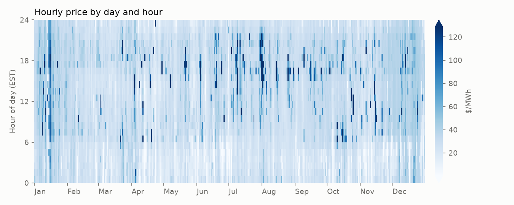

# Battery storage arbitrage in Ontario: value of information vs value of optimization

A 1 MW / 4 MWh battery buys and sells energy at Ontario's hourly price (HOEP) through
2024. This project measures how much of the money comes from knowing prices in advance
and how much comes from optimizing.

**Status:** work in progress. Runs end to end on 2024 data; verification and extensions under way.

## Questions

1. What is the most a battery could have earned with perfect knowledge of prices?
2. How much of that survives with the simplest possible forecast (yesterday's prices)?
3. What does optimization add over a simple charge-low, discharge-high rule?
4. How does a cost for battery wear change the answers?
5. When do the binary variables in the model matter?

## Method

**Battery.** 1 MW, 4 MWh, 88% round-trip efficiency (about 93.8% each way), state of
charge kept between 10% and 90%, every day starting and ending at 10%. An optional
degradation cost is charged per MWh of throughput.

**Model.** One mixed-integer linear program per day, written in Pyomo and solved with
HiGHS. For each hour `t` with price `p[t]`:

```
maximize    sum_t  p[t] * (d[t] - c[t])  -  kappa * (c[t] + d[t])

subject to  s[t] = s[t-1] + eta_c * c[t] - d[t] / eta_d
            s_min <= s[t] <= s_max
            c[t] <= P * u[t],   d[t] <= P * (1 - u[t]),   u[t] in {0, 1}
            s[24] = s[0]
```

`c` is charging power, `d` discharging power, `s` stored energy, `u` forbids charging
and discharging in the same hour, and `kappa` is the degradation cost.

**Strategies.** Every strategy is settled at the actual prices.

| Strategy | What it knows |
|---|---|
| Perfect foresight | Today's actual prices. An upper bound, not achievable. |
| Persistence | Yesterday's prices only. It commits to a 24-hour plan and never sees today's prices. |
| Threshold rule | Each hour's actual price, and two fixed thresholds tuned on January-June. Tested on July-December. |

**Two numbers.**

- Value of information = perfect foresight minus persistence.
- Persistence minus the threshold rule, on the test period. This does not isolate
  the value of optimization: the rule reacts to each hour's actual price, which
  the persistence plan never sees.

## Assumptions and limits

- The battery is a price-taker: its trades do not move the price.
- Energy arbitrage only. No operating reserve, capacity or Global Adjustment value,
  and no fees or network charges.
- Each day is planned on its own and ends where it started, so energy is never
  carried overnight.
- HOEP was retired on 30 April 2025 when Ontario's market was redesigned. The
  numbers describe the 2024 market, not today's.
- The threshold rule acts on each hour's actual HOEP, which is only known after
  the hour ends. A fair version would act on the pre-dispatch price.

## Run it

```
python -m venv .venv
.venv\Scripts\activate            # Windows.  macOS/Linux: source .venv/bin/activate
pip install -r requirements.txt

python -m pytest -q               # 15 checks, a few seconds
python examples/toy_lp.py         # prints: optimal 1.0 0.9 25.0
python run.py --synthetic         # made-up prices, to see that everything runs
```

Then download the price file as described in [data/README.md](data/README.md) and run:

```
python run.py --prices data/raw/PUB_PriceHOEPPredispOR_2024.csv --sweep-kappa 0,10,20,50 --lp-check
```

This writes `results/summary.md`, `results/daily_results.csv` and three figures in
`results/figures/`. It takes about a minute.

## Results

With perfect knowledge of each day’s prices, a 1 MW / 4 MWh battery would have earned $46,965 from energy arbitrage in 2024 ($46.8 per kW-year, 585 cycles). Planning each day on the previous day’s prices kept 33% of that ($15,586) and lost money on 98 days, so most of the value depended on the forecast. In the July–December test period, a two-price threshold rule tuned on January–June earned more than the optimizer running on that forecast ($11,386 against $9,920), with 157 cycles against 276. The rule had an advantage the optimizer did not: it acted on each hour's actual price, so this comparison does not isolate the value of optimization. A wear cost of $10 per MWh of throughput cut perfect-foresight revenue to $24,607 and made the persistence strategy lose money. HOEP was never negative in 2024, so the binary variables did not change the result; the LP relaxation gave the same revenue to within solver tolerance.

Source: IESO HOEP, file `PUB_PriceHOEPPredispOR_2024.csv`

- Period: 2024-01-01 to 2024-12-31 (366 days, 8,784 hours)
- Price: mean 32.19, min 0.00, max 1394.13 $/MWh; 0 negative hours, 78 zero hours
- Battery: 1 MW / 4 MWh, round-trip efficiency 88%, state of charge 10%-90%, each day starts and ends at 10%
- Degradation cost: $0 per MWh of throughput
- Price-taker, energy arbitrage only, no fees, charges or other revenue streams
- 366 daily MILPs solved in 5.6 s

### Whole period

The threshold rule is left out here because it was tuned on part of this period.

| Strategy | Net revenue ($) | $/kW-year | Cycles | $/cycle | Losing days | % of perfect foresight |
|---|---:|---:|---:|---:|---:|---:|
| perfect foresight | 46,965 | 46.8 | 585 | 80.3 | 0 | 100% |
| persistence | 15,586 | 15.5 | 583 | 26.7 | 98 | 33% |

Value of information (perfect foresight minus persistence): **$31,379**

### Test period (01 Jul 2024 onward)

Threshold rule tuned on data up to 30 Jun 2024: charge at or below $26.38 (45th percentile), discharge at or above $42.51 (90th percentile).

| Strategy | Net revenue ($) | $/kW-year | Cycles | $/cycle | Losing days | % of perfect foresight |
|---|---:|---:|---:|---:|---:|---:|
| perfect foresight | 26,231 | 52.0 | 275 | 95.4 | 0 | 100% |
| persistence | 9,920 | 19.7 | 276 | 36.0 | 42 | 38% |
| threshold rule | 11,386 | 22.6 | 157 | 72.3 | 12 | 43% |

- Value of information (perfect foresight minus persistence): **$16,311**
- Value of optimization (persistence minus threshold rule): **-$1,466**

### Degradation cost sweep (whole period)

| $/MWh throughput | Perfect foresight net ($) | Cycles | Persistence net ($) | Cycles | Persistence losing days |
|---:|---:|---:|---:|---:|---:|
| 0 | 46,965 | 585 | 15,586 | 583 | 98 |
| 10 | 24,607 | 203 | -3,468 | 203 | 198 |
| 20 | 15,991 | 91 | -6,592 | 91 | 125 |
| 50 | 6,272 | 25 | -6,663 | 25 | 50 |

### LP relaxation vs MILP (perfect foresight, whole period)

- MILP: $46,965
- LP (charging and discharging in the same hour allowed): $46,965
- Difference: $0.06







## Layout

```
battery_dispatch/
  battery.py      physical parameters
  data.py         IESO file loader, synthetic price generator
  model.py        the daily MILP
  simulate.py     settlement at actual prices, the threshold rule
  strategies.py   perfect foresight, persistence, threshold tuning
  evaluate.py     summary numbers
  plots.py        figures
run.py            runs everything
examples/toy_lp.py    a three-line storage problem to learn the tools
tests/            checks against answers worked out by hand
```
## Status and provenance

This repository is a work in progress. The analysis runs end to end on the 2024
IESO data and the results above come from that run. I am still verifying the
code and extending it.

The code was written with the help of an AI assistant (Claude, by Anthropic).
I ran the analysis on the IESO price file and reviewed the results.

Still to do:
- finish verifying each module against hand calculations
- an uncertainty estimate for the gap between the threshold rule and persistence
- a fair rule-versus-optimizer comparison, with both acting on the pre-dispatch price

## Possible extensions

- A real forecast (gradient boosting or ARIMA), with leakage-safe training.
- Battery duration: 2, 4 and 8 hours.
- Avoiding the province's five peak demand hours instead of energy arbitrage.
