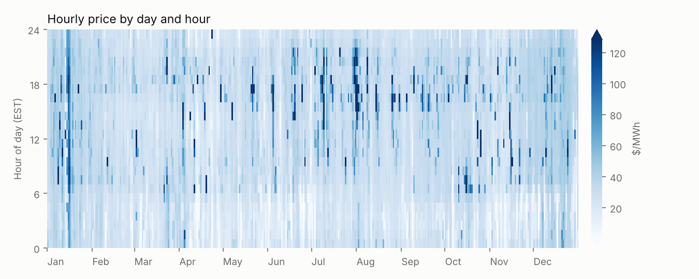

# Battery storage arbitrage in Ontario: value of information vs value of optimization

A 1 MW / 4 MWh battery buys and sells energy at Ontario's hourly price (HOEP) through
2024. This project measures how much of the money comes from knowing prices in advance
and how much comes from optimizing.

**Status:** the 2024 analysis is complete. Possible extensions are listed at the end.

## Questions

1. What is the most a battery could have earned with perfect knowledge of prices?
2. How much of that survives with the simplest possible forecast (yesterday's prices)?
3. What does optimization add over a simple charge-low, discharge-high rule?
4. How does a cost for battery wear change the answers?
5. When do the binary variables in the model matter?
6. Is the optimizer better than a simple rule when both have the same information?

## Method

**Battery.** 1 MW, 4 MWh, 88% round-trip efficiency (about 93.8% each way), state of
charge kept between 10% and 90%, every day starting and ending at 10%. An optional
degradation cost is charged per MWh of throughput.

**Model.** One mixed-integer linear program per day, written in Pyomo and solved with
HiGHS. For each hour `t` with price `p[t]`:

```
maximize    sum_t  p[t] * (d[t] - c[t])  -  kappa * (c[t] + d[t])

subject to  s[t] = s[t-1] + eta_c * c[t] - d[t] / eta_d
            s_min <= s[t] <= s_max
            c[t] <= P * u[t],   d[t] <= P * (1 - u[t]),   u[t] in {0, 1}
            s[24] = s[0]
```

`c` is charging power, `d` discharging power, `s` stored energy, `u` forbids charging
and discharging in the same hour, and `kappa` is the degradation cost.

**Strategies.** Every strategy is settled at the actual prices.

| Strategy | What it knows |
|---|---|
| Perfect foresight | Today's actual prices. An upper bound, not achievable. |
| Persistence | Yesterday's prices only. It commits to a 24-hour plan and never sees today's prices. |
| Threshold rule | Each hour's actual price, and two fixed thresholds tuned on January-June. Tested on July-December. |
| Threshold rule, pre-dispatch | The same rule, acting on IESO's 1-hour-ahead pre-dispatch price instead of the actual price. Tuned on January-June. |
| Optimizer, pre-dispatch | Re-plans the rest of the day at the start of every hour: pre-dispatch prices for the next three hours, yesterday's prices after that. Carries out only the first hour of each plan. |

**Comparisons.**

- Value of information = perfect foresight minus persistence.
- Persistence minus the threshold rule, on the test period. This does not isolate
  the value of optimization: the rule reacts to each hour's actual price, which
  the persistence plan never sees.
- Value of optimization = optimizer minus rule, both on pre-dispatch prices. Here
  both act only on what was known before each hour started: at the start of hour h,
  the 1-, 2- and 3-hour-ahead pre-dispatch prices for hours h, h+1 and h+2 were all
  published during hour h-1.

**Uncertainty.** Each gap is taken day by day, so both strategies face the same
prices, and the daily gaps are resampled in blocks of seven consecutive days
(a moving-block bootstrap, 10,000 resamples) to give a 95% interval.

## Assumptions and limits

- The battery is a price-taker: its trades do not move the price.
- Energy arbitrage only. No operating reserve, capacity or Global Adjustment value,
  and no fees or network charges.
- Each day is planned on its own and ends where it started, so energy is never
  carried overnight.
- HOEP was retired on 30 April 2025 when Ontario's market was redesigned. The
  numbers describe the 2024 market, not today's.
- The original threshold rule acts on each hour's actual HOEP, which is only known
  after the hour ends. The pre-dispatch comparison removes that advantage.
- Pre-dispatch prices are IESO's published projections; a real operator would also
  face bidding rules and dispatch instructions, which are not modelled.

## Run it

```
python -m venv .venv
.venv\Scripts\activate            # Windows.  macOS/Linux: source .venv/bin/activate
pip install -r requirements.txt

python -m pytest -q               # 41 checks, a few seconds
python examples/toy_lp.py         # prints: optimal 1.0 0.9 25.0
python run.py --synthetic         # made-up prices, to see that everything runs
```

Then download the price file as described in [data/README.md](data/README.md) and run:

```
python run.py --prices data/raw/PUB_PriceHOEPPredispOR_2024.csv --sweep-kappa 0,10,20,50 --lp-check
```

This writes `results/summary.md`, `results/daily_results.csv` and three figures in
`results/figures/`. It takes a few minutes, most of it the hourly re-planning in the
pre-dispatch comparison (`--no-predispatch` skips it).

## Results

With perfect knowledge of each day’s prices, a 1 MW / 4 MWh battery would have earned $46,965 from energy arbitrage in 2024 ($46.8 per kW-year, 585 cycles). Planning each day on the previous day’s prices kept 33% of that ($15,564) and lost money on 99 days, so most of the value depended on the forecast. In the July–December test period, a two-price threshold rule tuned on January–June earned more than the optimizer running on that forecast ($11,386 against $9,923). However, the gap is well within the noise (95% interval −$5,290 to $3,603), and the rule had an advantage the optimizer did not: it acted on each hour’s actual price. When both acted only on IESO’s pre-dispatch prices, which were known before each hour started, the optimizer re-planning every hour earned $10,998 and the rule $3,867. The difference, $7,130 (95% interval $4,865 to $10,163), is the value of optimization. A likely reason the rule did so poorly is that the 1-hour-ahead pre-dispatch price ran above the actual price in 79% of hours, by $6.83/MWh on average, so thresholds tuned on it did not carry over to the second half of the year. Re-planning hourly on pre-dispatch prices added $4,581 over yesterday’s plan across the year (95% interval $60 to $8,725), but only $1,075 in the test period, which cannot be told apart from zero. A wear cost of $10 per MWh of throughput cut perfect-foresight revenue to $24,607 and made the persistence strategy lose money. HOEP was never negative in 2024, so the binary variables did not change the result; the LP relaxation gave the same revenue to within solver tolerance.

Source: IESO HOEP, file `PUB_PriceHOEPPredispOR_2024.csv`

- Period: 2024-01-01 to 2024-12-31 (366 days, 8,784 hours)
- Price: mean 32.19, min 0.00, max 1394.13 $/MWh; 0 negative hours, 78 zero hours
- Battery: 1 MW / 4 MWh, round-trip efficiency 88%, state of charge 10%-90%, each day starts and ends at 10%
- Degradation cost: $0 per MWh of throughput
- Price-taker, energy arbitrage only, no fees, charges or other revenue streams
- 366 daily MILPs solved in 4.5 s

### Whole period

The threshold rule is left out here because it was tuned on part of this period.

| Strategy | Net revenue ($) | $/kW-year | Cycles | $/cycle | Losing days | % of perfect foresight |
|---|---:|---:|---:|---:|---:|---:|
| perfect foresight | 46,965 | 46.8 | 585 | 80.3 | 0 | 100% |
| persistence | 15,564 | 15.5 | 583 | 26.7 | 99 | 33% |
| optimizer, pre-dispatch | 20,144 | 20.1 | 528 | 38.2 | 46 | 43% |

Value of information (perfect foresight minus persistence): **$31,401**

### Test period (01 Jul 2024 onward)

Threshold rule tuned on data up to 30 Jun 2024: charge at or below $26.38 (45th percentile), discharge at or above $42.51 (90th percentile).

| Strategy | Net revenue ($) | $/kW-year | Cycles | $/cycle | Losing days | % of perfect foresight |
|---|---:|---:|---:|---:|---:|---:|
| perfect foresight | 26,231 | 52.0 | 275 | 95.5 | 0 | 100% |
| persistence | 9,923 | 19.7 | 276 | 36.0 | 42 | 38% |
| threshold rule | 11,386 | 22.6 | 157 | 72.3 | 12 | 43% |
| optimizer, pre-dispatch | 10,998 | 21.8 | 250 | 43.9 | 24 | 42% |
| threshold rule, pre-dispatch | 3,867 | 7.7 | 216 | 17.9 | 51 | 15% |

- Value of information (perfect foresight minus persistence): **$16,308**
- Persistence minus threshold rule: **-$1,463**. This is not a fair test of optimization: the rule acts on each hour's actual price, which the persistence plan never sees.

#### How sure are these two numbers?

Each gap is taken day by day (both strategies face the same prices), and the daily gaps are resampled in blocks of 7 consecutive days, 10,000 times (a moving-block bootstrap).

- Value of information: $16,308, 95% interval $13,143 to $19,652
- Persistence minus threshold rule: -$1,463, 95% interval -$5,290 to $3,603. Persistence earned more on 65 of 184 days, the rule on 119; persistence came out ahead in 27% of resamples.

### Fair comparison: both strategies on pre-dispatch prices (test period)

Both strategies now act only on what was known before each hour started. The rule charges or discharges on IESO's 1-hour-ahead pre-dispatch price. The optimizer re-plans the rest of the day at the start of every hour, using the 1-, 2- and 3-hour-ahead pre-dispatch prices for the next three hours and yesterday's prices after that, and carries out only the first hour of each plan. Both are settled at actual prices.

Rule tuned on pre-dispatch prices up to 30 Jun 2024: charge at or below $30.26 (45th percentile), discharge at or above $34.25 (60th percentile). 51 missing pre-dispatch values were filled with yesterday's price. The optimizer solved 8,760 hourly MILPs in 83 s. Over the year, the 1-hour-ahead pre-dispatch price was above the actual price in 79% of hours, by $6.83/MWh on average.

| Strategy | Net revenue ($) | $/kW-year | Cycles | $/cycle | Losing days | % of perfect foresight |
|---|---:|---:|---:|---:|---:|---:|
| perfect foresight | 26,231 | 52.0 | 275 | 95.5 | 0 | 100% |
| optimizer, pre-dispatch | 10,998 | 21.8 | 250 | 43.9 | 24 | 42% |
| threshold rule, pre-dispatch | 3,867 | 7.7 | 216 | 17.9 | 51 | 15% |
| persistence | 9,923 | 19.7 | 276 | 36.0 | 42 | 38% |

- Optimizer minus rule, both on pre-dispatch prices (the value of optimization): **$7,130**, 95% interval $4,865 to $10,163. The optimizer earned more on 145 of 184 days, the rule on 39; the optimizer came out ahead in 100% of resamples.
- Re-planning hourly on pre-dispatch prices instead of committing to yesterday's plan: **$1,075**, 95% interval -$2,692 to $3,745. Over the whole year (the optimizer is not tuned, so the first half is fair to include): $4,581, 95% interval $60 to $8,725.

### Degradation cost sweep (whole period)

| $/MWh throughput | Perfect foresight net ($) | Cycles | Persistence net ($) | Cycles | Persistence losing days |
|---:|---:|---:|---:|---:|---:|
| 0 | 46,965 | 585 | 15,564 | 583 | 99 |
| 10 | 24,607 | 203 | -3,451 | 203 | 198 |
| 20 | 15,991 | 91 | -6,602 | 91 | 125 |
| 50 | 6,272 | 25 | -6,671 | 25 | 50 |

### LP relaxation vs MILP (perfect foresight, whole period)

- MILP: $46,965
- LP (charging and discharging in the same hour allowed): $46,965
- Difference: $0.06





## Layout

```
battery_dispatch/
  battery.py      physical parameters
  data.py         IESO file loader, synthetic price generator
  model.py        the daily MILP
  simulate.py     settlement at actual prices, the threshold rule
  strategies.py   perfect foresight, persistence, threshold tuning
  rolling.py      the fair comparison: hourly re-planning on pre-dispatch prices
  evaluate.py     summary numbers
  plots.py        figures
run.py            runs everything
examples/toy_lp.py    a three-line storage problem to learn the tools
tests/            41 checks, most against answers worked out by hand
```
## Status and provenance

The 2024 analysis is complete. The results above come from running `run.py` on the
IESO price file, and each module is checked against small cases worked out by hand
(`tests/test_by_hand.py`).

The code was written with the help of an AI assistant (Claude, by Anthropic).
I reviewed the results.

A note on reproducing the numbers: with no wear cost, a day's prices often allow
several equally good plans, and different versions of the HiGHS solver do not
always pick the same one. Rerunning in November 2026 with a newer version changed
persistence revenue on 4 of 366 days, by $22 over the year. Perfect foresight and
the threshold rule were unchanged.

## Possible extensions

- A real forecast (gradient boosting or ARIMA), with leakage-safe training.
- Battery duration: 2, 4 and 8 hours.
- Avoiding the province's five peak demand hours instead of energy arbitrage.
