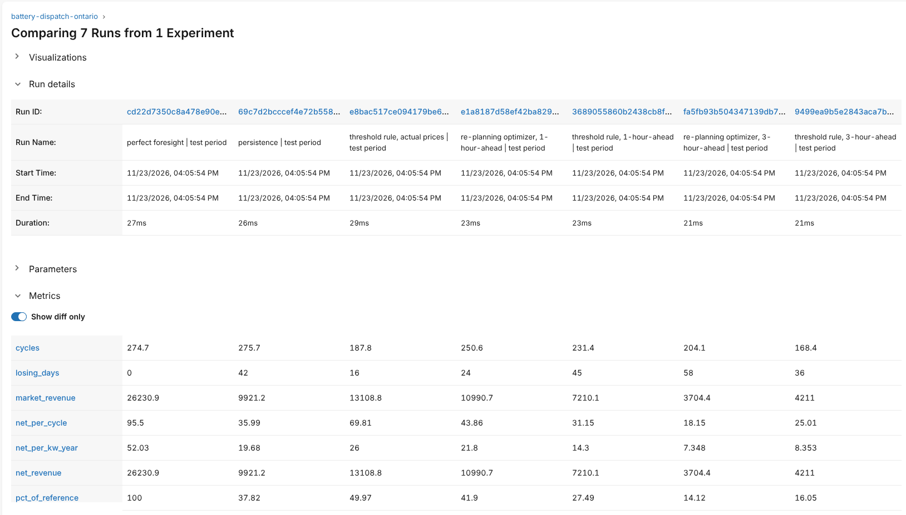
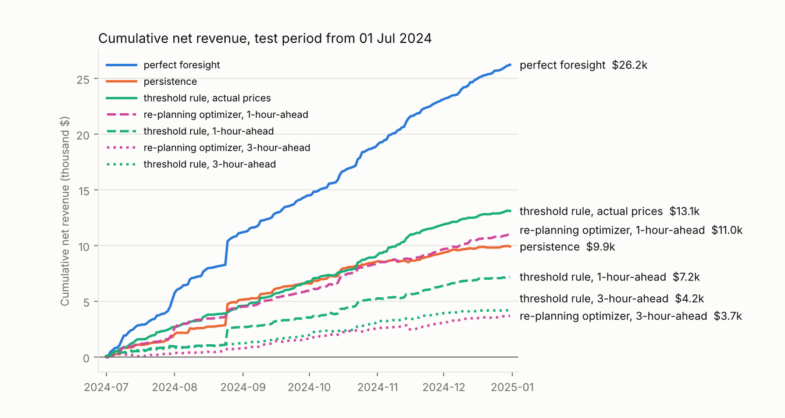
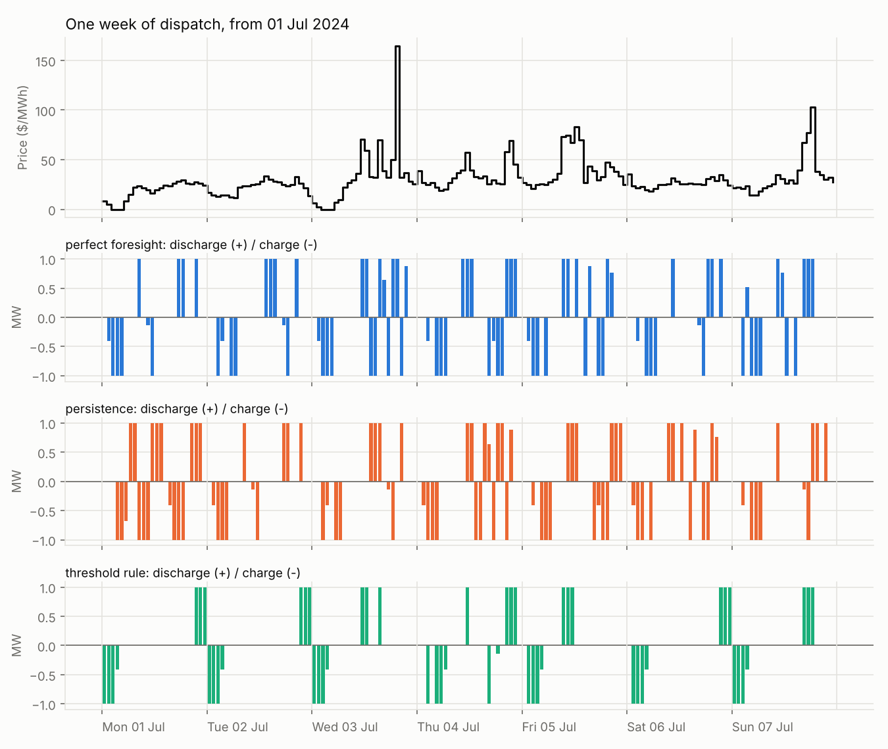

# Battery storage arbitrage in Ontario: value of information vs value of optimization

A 1 MW / 4 MWh battery buys and sells energy at Ontario's hourly price (HOEP) through
2024. This project measures how much of the money comes from knowing prices in advance
and how much comes from optimizing.

**Status:** the 2024 analysis is complete. It was revised in November 2026 after an
outside review, which changed the main comparison; see [Corrections](#corrections).

## Questions

1. What is the most a battery could have earned with perfect knowledge of prices?
2. How much of that survives with the simplest possible forecast (yesterday's prices)?
3. Does re-planning every hour on IESO's pre-dispatch price forecasts add to a plan made
   from yesterday's prices, and does it matter when the forecast arrives?
4. Is the optimizer better than a simple charge-low, discharge-high rule when both act
   on the same forecast?
5. How does a cost for battery wear change the answers?
6. When do the binary variables in the model matter?

## Method

**Battery.** 1 MW, 4 MWh, 88% round-trip efficiency (about 93.8% each way), state of
charge kept between 10% and 90%, every day starting and ending at 10%. An optional wear
cost is charged on every MWh charged or discharged.

**Model.** One mixed-integer linear program per day, written in Pyomo and solved with
HiGHS to proven optimality. For each hour `t` with price `p[t]`:

```
maximize    sum_t  p[t] * (d[t] - c[t])  -  kappa * (c[t] + d[t])

subject to  s[t] = s[t-1] + eta_c * c[t] - d[t] / eta_d
            s_min <= s[t] <= s_max
            c[t] <= P * u[t],   d[t] <= P * (1 - u[t]),   u[t] in {0, 1}
            s[24] = s[0]
```

`c` is charging power, `d` discharging power, `s` stored energy, `u` forbids charging
and discharging in the same hour, and `kappa` is the wear cost.

**Strategies.** Every strategy is settled at the actual prices.

| Strategy | What it acts on |
|---|---|
| Perfect foresight | Today's actual prices. An upper bound, not achievable. |
| Persistence | Yesterday's prices. The optimizer plans the day on them, and the plan is followed whatever happens. |
| Threshold rule, actual prices | Each hour's actual price, which is only known once the hour is over, against two thresholds tuned on January–June. Not achievable; kept for reference. |
| Re-planning optimizer, 1-hour-ahead | At the start of every hour, re-plans the rest of the day using IESO's 1-, 2- and 3-hour-ahead pre-dispatch prices for the next three hours and yesterday's prices after that, and carries out the first hour of the plan. |
| Threshold rule, 1-hour-ahead | The 1-hour-ahead pre-dispatch price for the coming hour, against two thresholds tuned on January–June. |
| Re-planning optimizer, 3-hour-ahead | As above, but with only the 3-hour-ahead price for the coming hour, and yesterday's prices after that. |
| Threshold rule, 3-hour-ahead | The 3-hour-ahead pre-dispatch price for the coming hour, against two thresholds tuned on January–June. |

**Timing.** In 2024, a participant's offers and bids for an hour were locked two hours
before the hour began (IESO's "mandatory window"; changes after that needed IESO's
approval). The 1-hour-ahead price is published after that point, so only the
3-hour-ahead strategies are ones a real battery could have run. The 1-hour-ahead ones
show what a later forecast would be worth.

**Tuning.** Each threshold rule's two prices are chosen on January–June from every pair
of percentiles from the 5th to the 95th (in steps of 5) with the lower one below the
upper one, then tested unchanged on July–December. Nothing else is tuned.

**Comparisons.**

- Value of information = perfect foresight minus persistence.
- Re-planning minus persistence: what hourly re-planning on each forecast adds to
  following yesterday's plan.
- Optimizer minus rule, both on the same pre-dispatch forecast.
- The threshold rule on actual prices minus persistence, for reference only.

**Checks.** The re-planning optimizers are also run with each forecast's bias removed
(its average error over all earlier days subtracted), and the 3-hour-ahead one with each
hour's actual price in place of the forecast. The test period's highest-price day is
reported on its own.

**Uncertainty.** Each gap is taken day by day, so both strategies face the same
prices, and the daily gaps are resampled in blocks of seven consecutive days
(a moving-block bootstrap, 10,000 resamples) to give a 95% interval.

The first day in the file (1 January) is used only as "yesterday" for the second, so
results run from 2 January.

## Assumptions and limits

- The battery is a price-taker: its trades do not move the price.
- Energy arbitrage only. No operating reserve, capacity or Global Adjustment value,
  and no fees or network charges.
- Each day is planned on its own and ends where it started, so energy is never
  carried overnight.
- HOEP was retired on 30 April 2025 when Ontario's market was redesigned. The
  numbers describe the 2024 market, not today's.
- Pre-dispatch prices are IESO's published projections. Bidding, dispatch
  instructions and the five-minute real-time market are not modelled; the timing
  above is the only market rule taken into account.

## Run it

```
python -m venv .venv
.venv\Scripts\activate            # Windows.  macOS/Linux: source .venv/bin/activate
pip install -r requirements.txt

python -m pytest -q               # 56 checks, about 15 seconds
python examples/toy_lp.py         # prints: optimal 1.0 0.9 25.0
python run.py --synthetic         # made-up prices, to see that everything runs
```

Then download the price file as described in [data/README.md](data/README.md) and run:

```
python run.py --prices data/raw/PUB_PriceHOEPPredispOR_2024.csv --sweep-kappa 0,10,20,50 --lp-check
```

This writes `results/summary.md`, `results/daily_results.csv` and three figures in
`results/figures/`. It takes about 20 minutes, almost all of it the hourly
re-planning, which is run five times and then twice more for each wear cost in the
sweep. Without `--sweep-kappa` it takes about ten minutes; `--no-predispatch` skips the
pre-dispatch strategies altogether.

### Tracking backtests with MLflow

Adding `--mlflow` also logs the backtest to MLflow, so that backtests stay comparable
as the model, the data or the battery changes:

```
python run.py --prices data/raw/PUB_PriceHOEPPredispOR_2024.csv --sweep-kappa 0,10,20,50 --lp-check --mlflow --run-name "2024 backtest"
mlflow ui                         # then open http://127.0.0.1:5000 in a browser
```

Each backtest is one parent run, holding what the whole backtest shares: a fingerprint
of the price file, the battery, the tuning period, the chosen thresholds, the comparisons
with their 95% intervals, and the summary, daily results and figures. Under it is one run
per strategy and period, and one per wear cost in the sweep. Their metrics have the same
names, so MLflow can sort and compare them side by side. The 2024 backtest is logged as
16 runs. Everything is stored locally, in `mlflow.db` and `mlruns/` in the project folder.



## Results

With perfect knowledge of each day's prices, a 1 MW / 4 MWh battery would have earned $46,941 from energy arbitrage in 2024 ($46.9 per kW-year, 584 cycles). Planning each day on the previous day's prices kept 33% of that ($15,561) and lost money on 99 days, so most of the value depended on the price forecast.

Re-planning every hour on IESO's pre-dispatch prices did not clearly help. With the forecast published one hour ahead, which a real battery could not have acted on (in 2024, offers for an hour were locked two hours before it began), re-planning added $1,070 (95% interval -$2,701 to $3,738) to the plan made from yesterday's prices in July–December, and $4,586 (95% interval -$74 to $8,800) over the year; neither can be told apart from zero. With the 3-hour-ahead forecast, which does arrive in time, re-planning earned less than yesterday's plan in July–December, by $6,217 (95% interval $3,193 to $10,814). The forecasts ran high, and removing that bias cut the loss to $3,896 without removing it. Given each hour's actual price instead of the forecast, the same re-planning would have earned $8,803 more than with the forecast (95% interval $6,333 to $11,806), finishing level with or ahead of yesterday's plan ($2,586 ahead, 95% interval -$2,313 to $6,087). So the loss comes from the forecast's errors.

On the same 1-hour-ahead forecast, the optimizer earned $3,781 more than a threshold rule tuned on January–June (95% interval $676 to $7,116). On the 3-hour-ahead forecast the two could not be told apart (optimizer minus rule: -$507, 95% interval -$2,022 to $1,012). A rule acting on each hour's actual price, which nobody knows in advance, earned $13,109, more than any strategy that could actually have been run.

One day weighs heavily on these comparisons: on 25 August the price reached $1,394/MWh, and that day gave persistence 19%, and the threshold rule on the 1-hour-ahead forecast 20%, of their July–December revenue. A wear cost of $10 for every MWh charged or discharged (about $64 per full cycle) cut perfect-foresight revenue to $24,607 and made persistence (-$3,451) and 3-hour-ahead re-planning (-$3,637) lose money over the year. HOEP was never negative in 2024, so the binary variables did not change the result; solved to proven optimality, the LP relaxation gave the same revenue to the cent.

Source: IESO HOEP, file `PUB_PriceHOEPPredispOR_2024.csv`

- Price file: 2024-01-01 to 2024-12-31 (366 days, 8,784 hours); mean 32.19, min 0.00, max 1394.13 $/MWh; 0 negative hours, 78 zero hours
- Evaluated: 2024-01-02 to 2024-12-31 (365 days). The first day only serves as "yesterday" for the second.
- Battery: 1 MW / 4 MWh, round-trip efficiency 88%, state of charge 10%-90%, each day starts and ends at 10%
- Wear cost: $0 per MWh charged or discharged
- Price-taker, energy arbitrage only, no fees, charges or other revenue streams
- 366 daily MILPs solved in 4.6 s

### Whole period

Only the strategies with nothing tuned to the data; the threshold rules were tuned on part of it.

| Strategy | Net revenue ($) | $/kW-year | Cycles | $/cycle | Losing days | % of perfect foresight |
|---|---:|---:|---:|---:|---:|---:|
| perfect foresight | 46,941 | 46.9 | 584 | 80.4 | 0 | 100% |
| persistence | 15,561 | 15.6 | 583 | 26.7 | 99 | 33% |
| re-planning optimizer, 1-hour-ahead | 20,147 | 20.1 | 528 | 38.2 | 45 | 43% |
| re-planning optimizer, 3-hour-ahead | 8,391 | 8.4 | 420 | 20.0 | 111 | 18% |

- Value of information (perfect foresight minus persistence): **$31,380**, 95% interval $26,843 to $36,515
- Re-planning hourly on the 1-hour-ahead forecast minus persistence: **$4,586**, 95% interval -$74 to $8,800
- Re-planning hourly on the 3-hour-ahead forecast minus persistence: **-$7,170**, 95% interval -$12,470 to -$3,068

### Test period (01 Jul 2024 onward)

Threshold rules tuned on 02 Jan 2024 to 30 Jun 2024, trying every pair of percentiles (5th to 95th, in steps of 5) with the lower one below the upper one:

- threshold rule, actual prices: charge at or below $28.66 (55th percentile), discharge at or above $42.53 (90th percentile)
- threshold rule, 1-hour-ahead: charge at or below $34.27 (60th percentile), discharge at or above $43.00 (80th percentile)
- threshold rule, 3-hour-ahead: charge at or below $27.63 (40th percentile), discharge at or above $32.68 (60th percentile)

| Strategy | Net revenue ($) | $/kW-year | Cycles | $/cycle | Losing days | % of perfect foresight |
|---|---:|---:|---:|---:|---:|---:|
| perfect foresight | 26,231 | 52.0 | 275 | 95.5 | 0 | 100% |
| persistence | 9,921 | 19.7 | 276 | 36.0 | 42 | 38% |
| threshold rule, actual prices | 13,109 | 26.0 | 188 | 69.8 | 16 | 50% |
| re-planning optimizer, 1-hour-ahead | 10,991 | 21.8 | 251 | 43.9 | 24 | 42% |
| threshold rule, 1-hour-ahead | 7,210 | 14.3 | 231 | 31.2 | 45 | 27% |
| re-planning optimizer, 3-hour-ahead | 3,704 | 7.3 | 204 | 18.1 | 58 | 14% |
| threshold rule, 3-hour-ahead | 4,211 | 8.4 | 168 | 25.0 | 36 | 16% |

#### Comparisons

Each gap is taken day by day (both strategies face the same prices), and the daily gaps are resampled in blocks of 7 consecutive days, 10,000 times (a moving-block bootstrap), for the 95% interval.

- Value of information (perfect foresight minus persistence): **$16,310**, 95% interval $13,145 to $19,654. Perfect foresight earned more on 184 of 184 days, persistence on 0; perfect foresight came out ahead in 100% of resamples.
- Threshold rule on actual prices minus persistence (not achievable: the rule acts on each hour's price, known only once the hour is over): **$3,188**, 95% interval -$1,963 to $7,225. The rule earned more on 123 of 184 days, persistence on 61; the rule came out ahead in 90% of resamples.
- Optimizer minus rule, both on the 1-hour-ahead forecast: **$3,781**, 95% interval $676 to $7,116. The optimizer earned more on 132 of 184 days, the rule on 52; the optimizer came out ahead in 99% of resamples.
- Optimizer minus rule, both on the 3-hour-ahead forecast: **-$507**, 95% interval -$2,022 to $1,012. The optimizer earned more on 89 of 184 days, the rule on 88; the optimizer came out ahead in 31% of resamples.
- Re-planning hourly on the 1-hour-ahead forecast minus persistence: **$1,070**, 95% interval -$2,701 to $3,738. Re-planning earned more on 111 of 184 days, persistence on 73; re-planning came out ahead in 74% of resamples.
- Re-planning hourly on the 3-hour-ahead forecast minus persistence: **-$6,217**, 95% interval -$10,814 to -$3,193. Re-planning earned more on 72 of 184 days, persistence on 112; re-planning came out ahead in 0% of resamples.

Only the 3-hour-ahead timing is one a real battery could have acted on: in 2024, offers and bids for an hour were locked two hours before it began (IESO's mandatory window), and the 1-hour-ahead price is published after that.

#### The pre-dispatch forecasts

The optimizer solved 8,760 hourly MILPs in 81 s for each run. Missing pre-dispatch values were filled with yesterday's price for the same hour: 17 for the 1-hour-ahead price, 17 for the 2-hour-ahead price, 17 for the 3-hour-ahead price.

Forecast minus actual price, over the hours that have a forecast:

| Forecast | Above the actual price | Mean error ($/MWh) | Mean error, Jan-Jun | Mean error, Jul-Dec |
|---|---:|---:|---:|---:|
| 1-hour-ahead | 79% | +6.85 | +5.88 | +7.82 |
| 2-hour-ahead | 77% | +6.40 | +5.31 | +7.48 |
| 3-hour-ahead | 71% | +4.46 | +3.68 | +5.24 |

Removing the bias (subtracting each forecast's average error over all earlier days) changes the re-planning optimizer's test-period revenue as follows:

- 1-hour-ahead: $10,991 as published, $11,473 with the bias removed; minus persistence, $1,552 (95% interval -$2,301 to $4,394)
- 3-hour-ahead: $3,704 as published, $6,025 with the bias removed; minus persistence, -$3,896 (95% interval -$6,316 to -$2,116)

As a check of the method, the 3-hour-ahead re-planning was also given each hour's actual price in place of the forecast. It then earned $12,507 in the test period: $8,803 more than with the forecast (95% interval $6,333 to $11,806), and $2,586 more than persistence (95% interval -$2,313 to $6,087). So the losses above come from the forecast's errors: with an exact price for the coming hour, re-planning does not fall behind yesterday's plan.

#### One day: 25 Aug 2024

The highest price in the test period, $1,394.13/MWh, came on 25 Aug 2024. What each strategy earned that day, and in the rest of the test period:

| Strategy | That day ($) | Share of its test-period total | Rest of the test period ($) |
|---|---:|---:|---:|
| perfect foresight | 2,109 | 8% | 24,122 |
| persistence | 1,891 | 19% | 8,030 |
| threshold rule, actual prices | 94 | 1% | 13,015 |
| re-planning optimizer, 1-hour-ahead | 522 | 5% | 10,468 |
| threshold rule, 1-hour-ahead | 1,420 | 20% | 5,791 |
| re-planning optimizer, 3-hour-ahead | 197 | 5% | 3,507 |
| threshold rule, 3-hour-ahead | 78 | 2% | 4,133 |

### Wear cost sweep (whole period)

Wear is charged on every MWh charged or discharged, so $10/MWh comes to about $64 for a full cycle of the usable 3.2 MWh.

| Wear cost ($/MWh) | Perfect foresight ($) | Cycles | Persistence ($) | Cycles | Persistence losing days | Re-planning, 1-hour-ahead ($) | Re-planning, 3-hour-ahead ($) |
|---:|---:|---:|---:|---:|---:|---:|---:|
| 0 | 46,941 | 584 | 15,561 | 583 | 99 | 20,147 | 8,391 |
| 10 | 24,607 | 203 | -3,451 | 203 | 198 | 143 | -3,637 |
| 20 | 15,991 | 91 | -6,602 | 91 | 125 | -4,191 | -6,507 |
| 50 | 6,272 | 25 | -6,672 | 25 | 50 | -4,676 | -5,730 |

### LP relaxation vs MILP (perfect foresight, whole period)

- MILP: $46,941
- LP (charging and discharging in the same hour allowed): $46,941
- Difference: $0.00






## Corrections

**November 2026.** An outside review of this repository found problems that changed the
main comparison. The first version of the results:

- **Tuned the threshold rules over too narrow a range.** Low thresholds above the 45th
  percentile were never tried, and both rules picked the 45th, the edge of the search.
  With every pair of percentiles tried, the rule on the 1-hour-ahead forecast earns
  $7,210 in July–December instead of $3,867, and the optimizer's lead over it falls
  from $7,130 to $3,781.
- **Treated the 1-hour-ahead forecast as one a battery could act on.** Under IESO's 2024
  rules it arrives after an hour's offers are locked. The 3-hour-ahead strategies are new.
- **Said the optimizer and the rule had the same information.** They had the same
  forecast, but the optimizer also used the 2- and 3-hour-ahead prices and yesterday's
  prices, which the rule ignores.
- **Explained the rule's poor result by the forecast's upward bias.** A steady bias would
  carry over from the tuning period to the test period, although the 1-hour-ahead bias
  did grow, from $5.88 to $7.82/MWh. The narrow search accounted for about half of the
  rule's shortfall against the optimizer. The bias is now measured for each forecast, and
  removed in a separate check.
- **Handled the first day unevenly.** Some strategies traded on 1 January while others
  could not, and a missing forecast on that day would have been filled with that day's
  actual price (none was missing in 2024). The first day is now used only as "yesterday".
- **Stopped the solver within 0.01% of the optimum,** which left the MILP $0.06 below its
  LP relaxation over the year. It now solves to proven optimality. With the first-day
  change, this moved some totals by a few dollars (persistence, July–December: $9,923 to
  $9,921).
- **Smaller fixes.** The threshold rule now uses the whole battery when a day starts above
  the lower limit; the feasibility check now refuses charging and discharging in the same
  hour and checks the reported state of charge; the one-week figure shows every strategy;
  the wear-cost sweep includes the re-planning optimizers; the forecast-error figures leave
  out the hours whose forecast was missing; and a function that still computed the first,
  unfair comparison under the name "value of optimization" was removed.

Each fix has a test that fails on the old code (`tests/test_audit_fixes.py`).

## Layout

```
battery_dispatch/
  battery.py      physical parameters
  data.py         IESO file loader, synthetic price generator
  model.py        the daily MILP
  simulate.py     settlement at actual prices, the threshold rule
  strategies.py   perfect foresight, persistence, threshold tuning, strategy names
  rolling.py      hourly re-planning on pre-dispatch prices, both timings, bias removal
  evaluate.py     summary numbers, bootstrap intervals
  plots.py        figures
  tracking.py     logging a backtest to MLflow
run.py            runs everything
examples/toy_lp.py    a three-line storage problem to learn the tools
tests/            56 checks, most against answers worked out by hand
docs/             screenshot of the MLflow comparison
```

## Status and provenance

The 2024 analysis is complete. The results above come from running `run.py` on the
IESO price file, and each module is checked against small cases worked out by hand
(`tests/test_by_hand.py`).

The code was written with the help of an AI assistant (Claude, by Anthropic).
I reviewed the results.

A note on reproducing the numbers: with no wear cost, a day's prices often allow
several equally good plans, and different versions of the HiGHS solver do not
always pick the same one. Rerunning in November 2026 with a newer version changed
persistence revenue on 4 of 366 days, by $22 over the year, before the solver was
set to prove optimality. A different version may still pick a different plan of
equal value, and so move persistence and the re-planning optimizers by a few dollars.

## Possible extensions

- A real forecast (gradient boosting or ARIMA), with leakage-safe training.
- Battery duration: 2, 4 and 8 hours.
- Avoiding the province's five peak demand hours instead of energy arbitrage.
